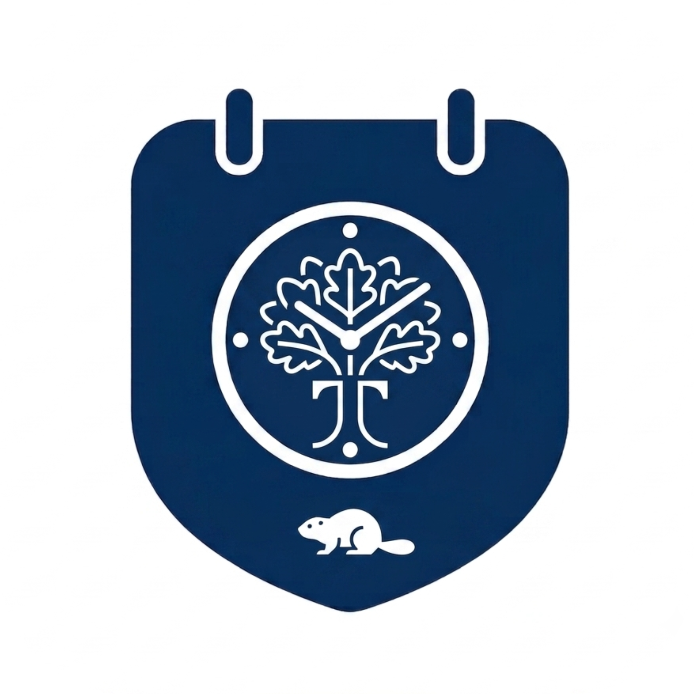
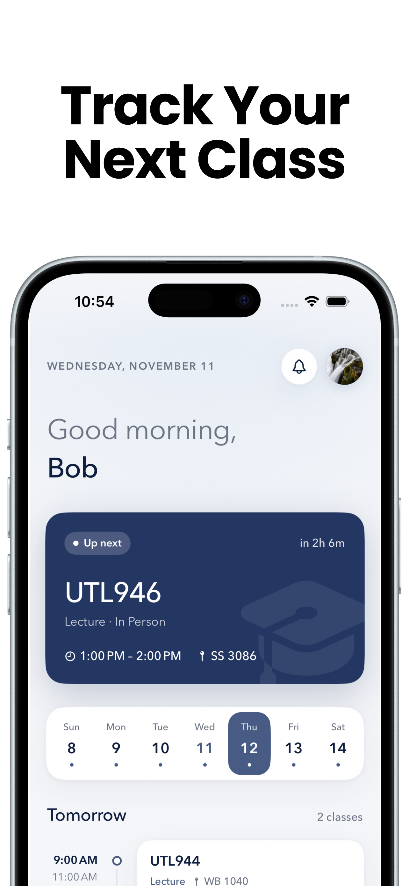
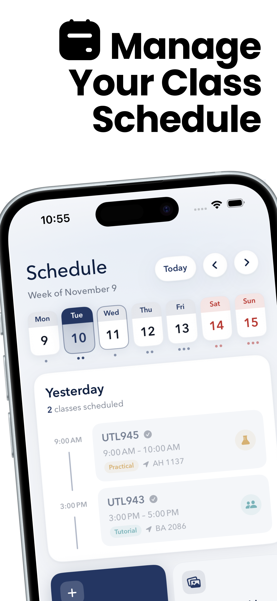
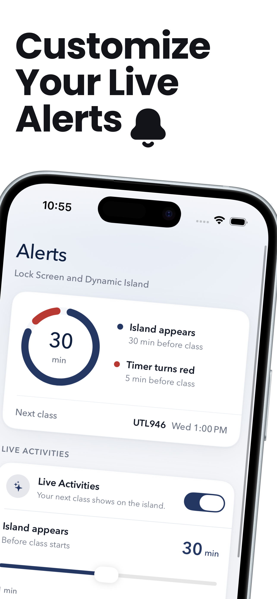
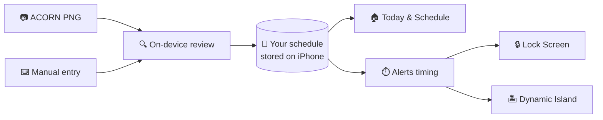
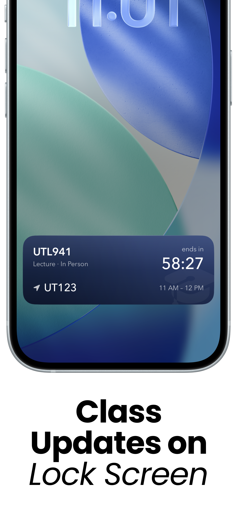
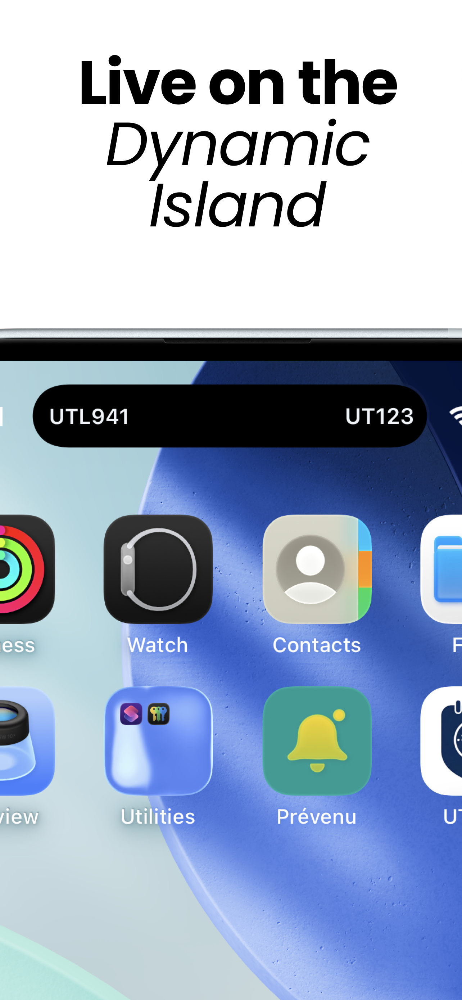
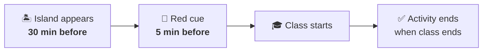
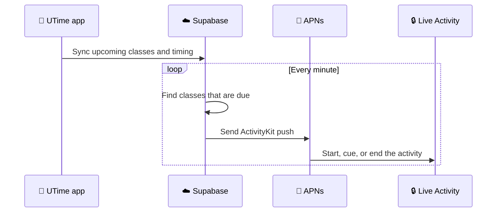

<p align="center">
  
</p>

<h1 align="center">UTime</h1>

<p align="center">
  <strong>A clean iOS timetable companion for University of Toronto students.</strong>
</p>

<p align="center">
  
  
  
  
  
</p>

<p align="center">
  Upload your ACORN timetable image or enter your courses manually, then use <strong>Today</strong>, <strong>Schedule</strong>, <strong>Alerts</strong>, and <strong>Profile</strong> to keep your next class, room, delivery mode, and Live Activity timing close at hand.
</p>

<p align="center">
  
  
  
</p>

## Overview

UTime turns a weekly U of T timetable into a practical class companion for iPhone. Instead of checking a full calendar every time you need a room, UTime focuses on the question students usually care about most:

> **What is my next class, when does it start, and where do I need to go?**

The app is organized around a bottom navigation bar with four focused sections:

| | Section | What it does |
| :-: | --- | --- |
| 🏠 | **Today** | Shows the next class, the room, and a compact overview of the day. |
| 📅 | **Schedule** | Handles PNG import, manual course entry, clearing, and upcoming class management. |
| ⏱️ | **Alerts** | Controls when Live Activities appear and when urgent cues should start. |
| 👤 | **Profile** | Keeps local student context and app actions in one quiet place. |

### How it works



## ✨ v3.1 Highlights

Version `3.1` redesigns the Schedule and Alerts tabs to match the Today and Profile headers, polishes light mode, and adds in-app update prompts.

| | What's new |
| :-: | --- |
| 📅 | **Redesigned Schedule:** A header card shows today’s date, a strip of the next seven days with a dot for each class, and counts for today, this week, and upcoming. **Add a course** and **Upload timetable** sit side by side as two tiles. |
| 🗂️ | **Classes grouped by day:** Upcoming classes are listed under **Today**, **Tomorrow**, and dated headings. Each row shows the start and end time, a color-coded tag for lectures, tutorials, labs, and seminars, and the room or delivery mode. |
| ⏱️ | **Redesigned Alerts:** A header card previews the Live Activity for your next class and shows a timeline of when the island appears, when the red cue starts, and when class begins. The timing controls and **Alert Status** are grouped into cleaner panels. |
| ➕ | **Quick add on Today:** With no classes saved, the **Next Class** card offers the same **Add a course** and **Upload timetable** tiles as Schedule. |
| ☀️ | **Light mode polish:** Blue accents are lighter in light mode, and the Live Activity preview uses a light card instead of solid black. Dark mode keeps its deeper blues and black island. |
| 🔔 | **Update prompts:** When a newer UTime version is on the App Store, the app offers to open it. Choosing **Later** hides the prompt for 24 hours. |

> [!NOTE]
> PNG import and manual entry remain available; **ICS import remains removed.**

## Screenshots

> [!NOTE]
> The images below and above show earlier app screens; the v3.1 screens are not pictured yet.

<p align="center">
  
  
</p>

UTime is designed around native iPhone surfaces instead of becoming another heavy calendar screen. The app keeps the main interface **calm**, then uses Lock Screen and Dynamic Island surfaces **when timing matters**.

## Core Features

### 🏠 Today

The **Today** section is the main landing view. It highlights the next class with the **course code, section details, start time, date, and room** when one is available. Below that, the overview panel keeps the day readable with counts for classes today, upcoming classes, alert timing, and Dynamic Island status.

> [!TIP]
> With no classes saved, the **Next Class** card shows the **Add a course** and **Upload timetable** tiles instead.

### 📅 Schedule

The **Schedule** section opens with a seven-day strip and class counts, then lists upcoming classes grouped by day. **Swipe left on a class to delete it.**

- **Add a course** manually, with term dates and weekly lecture, tutorial, lab, or seminar meetings. Review generated class dates and swipe to exclude holidays before saving. New courses are **appended** to the existing schedule.
- **Upload timetable** scans an ACORN PNG from Files or Photos. Recognition runs **on-device**, and all extracted courses can be edited before saving.

> [!WARNING]
> Saving an uploaded timetable **replaces your current schedule**. Use **Add a course** if you only want to add to it.

### ⏱️ Alerts

The **Alerts** section controls how early UTime starts Live Activity updates before class. It also lets users choose a **red-alert cue**, so the app can become more noticeable as the start time gets closer. A preview at the top shows how the Live Activity will look for your next class, with a timeline of when the island appears and when the red cue starts.

### 👤 Profile

The **Profile** section shows your name and campus in a hero card, with program, campus, year, and scheduled class count in one details card. It also includes a small **Rate UTime** row for users who want to leave an App Store review, without turning the page into a promotion screen.

## Live Activities

UTime uses native iOS Live Activities to keep the next class visible when it matters most:

| Surface | What you see |
| --- | --- |
| 🔒 **Lock Screen** | The course, room or delivery mode, countdown, and start time. |
| 🏝️ **Dynamic Island** | A compact view focused on the course and room, with the course code tucked against the camera cutout. |
| ⏱️ **Alert timing** | Adjustable, so updates appear before class instead of at the last second. |
| 🔴 **Red-alert cues** | Make the final minutes before class easier to notice. |

The timeline below uses the defaults, both adjustable in **Alerts**:



> [!IMPORTANT]
> The red cue must come **after** the island appears, so cue options longer than your island timing are disabled.

The goal is not to mirror the whole schedule on the Lock Screen. UTime only surfaces **the immediate next class**, which keeps the experience focused and glanceable.

## Timetable Entry

Manual entry uses **Toronto time** and expands weekly meetings across the selected term, preserving local class times across daylight-saving changes. Set in-person locations or mark a meeting as online. Saved occurrences can be deleted individually from Schedule.

> [!WARNING]
> **Holidays and reading week are not excluded automatically.** Review class dates before saving and swipe away any that don't apply.

> [!CAUTION]
> PNG import reads the **full Course / Day / Time / Location table** beneath the grid. **Grid-only screenshots are not supported.**

<details>
<summary><strong>How PNG import handles your image</strong></summary>

<br>

ICS import has been removed. Existing saved schedules remain available. Uploading a PNG replaces the current schedule.

- The review includes the original image and requires confirmation of meetings and exact term dates.
- The importer rescans the table separately from browser controls and matches course labels to the grid’s chronological hour sequence.
- **Unmarked AM/PM still requires confirmation.**
- Missing or unreadable fields stay in the editable draft with review flags instead of rejecting the entire schedule; unresolved times show explicitly labeled placeholders.
- One “I checked all meetings and term dates” confirmation covers the reviewed scan; missing days, course codes, and invalid times must still be corrected.
- Lecture section numbers are optional.
- The image does not provide holidays or the winter schedule of a year-long course.

</details>

## 🔐 Privacy and Data

UTime is built around local timetable use:

- ✅ Student profile details **stay on device**.
- ✅ Timetable image recognition **runs on-device**; the image is not uploaded for OCR.
- ✅ Imported class data is used to power the app’s schedule and Live Activity views.
- ✅ **No account is required** to import or view a timetable.
- ✅ Live Activity support uses only the data needed to show class updates.

Read the full privacy policy at [jamieryu.com/UTime/privacy](https://jamieryu.com/UTime/privacy/index.html).

## Add a Timetable in the App

### 📷 Upload an ACORN PNG

1. Open **Schedule** and tap **Upload timetable**.
2. Choose **Choose from Photos** or **Choose PNG from Files**. Include the entire grid with hour labels and the full Course / Day / Time / Location table; Safari bars are okay.
3. After recognition finishes, tap **Review & import** at the bottom.
4. Compare the extracted courses with the original PNG, correct any details, and set the exact term dates. Correct any flagged meeting details, including AM/PM, before confirming the scan.
5. Turn on **I checked all meetings and term dates**, then tap **Upload timetable** to save.
6. To exclude holidays, reading week, or cancelled classes first, open **Preview class dates (optional)**, swipe left on dates, and tap **Upload timetable**.

> [!IMPORTANT]
> Images must be **20 MB or smaller**.

> [!TIP]
> Uploading replaces your existing schedule, so **re-uploading never doubles your classes**.

### ⌨️ Enter courses manually

1. Open **Schedule** and tap **Add a course**.
2. Enter the course, term dates, and weekly meetings. Use **Add another meeting** for additional days, tutorials, or labs.
3. Tap **Save course**, or open **Preview class dates (optional)** to remove excluded dates before saving.
4. Repeat for the next course; **term dates are remembered**.

> [!TIP]
> Open **Alerts** to set Live Activity timing after saving your timetable.

## Automatic Live Activity Sync

Supabase checks due classes **every minute** and sends ActivityKit pushes through APNs. Schedule uploads are atomic and retain delivery progress on retries. Failed devices are isolated so they do not stop the batch.



The app retries temporary connection failures and resyncs when opened. In **Alerts → Alert Status**, look for **Automatic updates ready**, or tap **Retry connection** if it shows setting up or unavailable.

> [!IMPORTANT]
> After installing an updated build on your iPhone, **open it online once to sync.**

> [!WARNING]
> **A successful sync or APNs response does not prove that iOS displayed the activity.** Test a class with the app in the background and the phone locked, checking its start, countdown cue, and end.

## 🛠️ For Developers

### Tech Stack

| Area | Tools |
| --- | --- |
| Language & UI | Swift, SwiftUI |
| Storage | SwiftData |
| Timetable import | Vision, PhotosUI |
| Live Activities | ActivityKit, WidgetKit |
| Backend | Supabase Edge Functions |
| Minimum OS | iOS 17.6+ |

### Project Layout

```text
UofTimetable/          Main iOS app
UofTimetableWidget/    Live Activity and widget extension
UofTimetableShared/    Shared ActivityKit attributes
supabase/              Edge functions and migrations
privacy/               Privacy policy page
```

### Run Locally

1. Open `UofTimetable.xcodeproj` in Xcode.
2. Select the `UofTimetable` scheme.
3. Choose an iPhone simulator or connected iPhone.
4. Build and run.

> [!NOTE]
> For Live Activities, use a device or simulator/runtime that supports ActivityKit.

<details>
<summary><strong>Checks</strong></summary>

<br>

```sh
node --experimental-strip-types tests/backend-sync.mjs
swiftc UofTimetable/CourseReminderSnapshot.swift UofTimetable/ManualCourse.swift tests/ManualCourseChecks.swift -o /tmp/manual-course-checks
/tmp/manual-course-checks
swiftc UofTimetable/CourseReminderSnapshot.swift UofTimetable/ManualCourse.swift UofTimetable/TimetableImageParser.swift tests/TimetableImageChecks.swift -o /tmp/timetable-image-checks
/tmp/timetable-image-checks
```

Database regression checks are in `tests/backend-sync.sql`. They verify retry preservation, failure rollback, due filtering, and schedule clearing.

⚠️ **Run the database checks with the migration loaded inside a transaction and always roll back.**

The image checks also accept the original sample PNG path as an argument to validate actual Vision output against the expected four courses and nine weekly meetings.

</details>

## Notes

The App Store review action opens UTime’s App Store review page directly, which makes the Profile review row reliable when someone chooses to use it.

## Copyright

Copyright (c) 2026 Jamie Ryu. All rights reserved.
